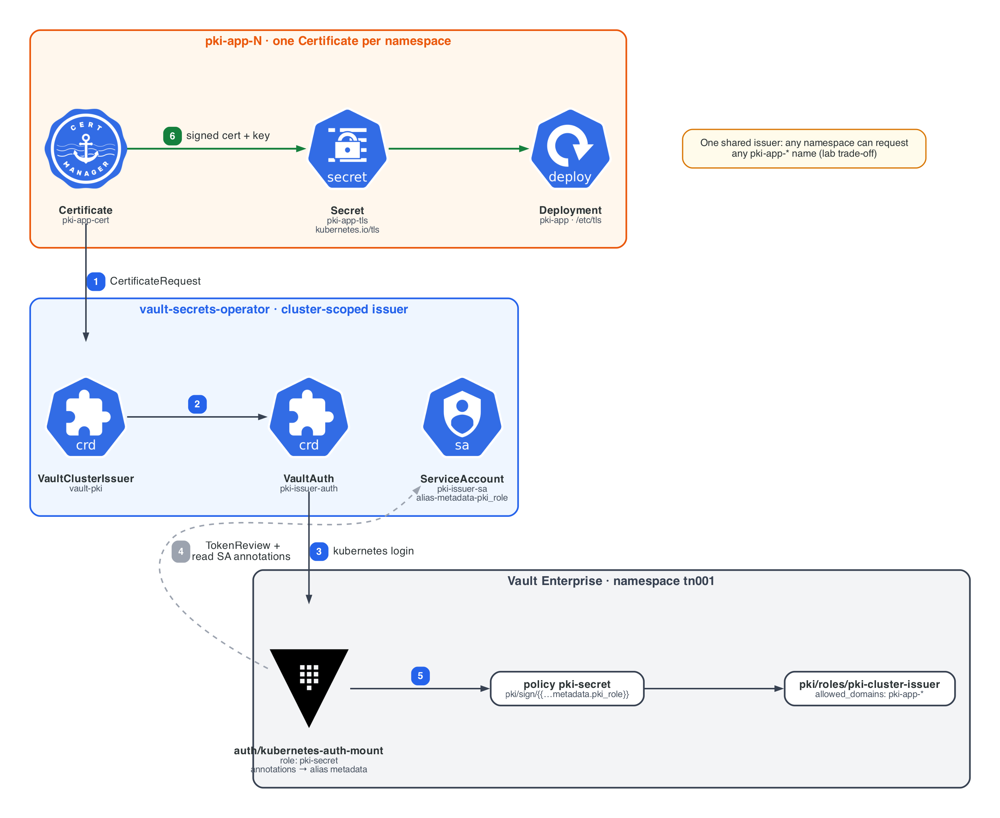

# PKI Secrets Example

Issues a TLS certificate per namespace with [cert-manager](https://cert-manager.io/). Each app creates a
cert-manager `Certificate`, and VSO's `VaultClusterIssuer` (VSO 2.0+) has it signed by the Vault `pki` mount.
The issuer logs in as one annotated service account; a templated policy uses that annotation metadata to pin the
issuer to its PKI role.

- Manifests: [`vault-ent/pki-secrets/`](../vault-ent/pki-secrets/)
- Script: [`scripts/config-pki-secret.sh`](../scripts/config-pki-secret.sh)
- Tasks: `task config:pki-secret`, `task deploy:pki-secret`, `task verify:pki-secret`, `task rotate:pki-secret`
- Instances: controlled by the `pki_app_count` variable (default 3)
- cert-manager is installed by `task install` (`install:cert-manager`); `task config:pki-secret` needs both cert-manager
  and VSO running, because it applies the `VaultClusterIssuer` and waits for it
- `VaultIssuer`/`VaultClusterIssuer` only work with a licensed Vault Enterprise server
  ([setup](https://developer.hashicorp.com/vault/docs/deploy/kubernetes/vso/cert-manager/setup))
- Upgrading a lab deployed with the earlier `VaultPKISecret` version: run `task uninstall` first, otherwise VSO and
  cert-manager both write `pki-app-tls`

## Architecture



## How it works

1. Each `pki-app-N` has a cert-manager `Certificate` whose `issuerRef` is
   `{group: secrets.hashicorp.com, kind: VaultClusterIssuer, name: vault-pki}`. cert-manager generates the key,
   creates a `CertificateRequest` (auto-approved via the VSO chart's `certManager.approverRBAC`), and VSO sends the
   CSR to Vault. cert-manager writes the result to `pki-app-tls` and renews it 15 minutes before expiry.
2. The issuer logs in to `kubernetes`, a **kubernetes** auth mount in `tn001`, as
   `vault-secrets-operator/pki-issuer-sa`. With `use_annotations_as_alias_metadata=true`, Vault reads the SA and
   copies each `vault.hashicorp.com/alias-metadata-<key>` annotation into the alias metadata
   (`vault-ent/vault-sa-reader-rbac.yaml` grants the reviewer token `get serviceaccounts`).
3. The `pki-secret` policy is written with the mount accessor filled in:
   ```hcl
   path "pki/sign/{{identity.entity.aliases.<accessor>.metadata.pki_role}}" { ... }
   ```
   so the issuer can only sign with `pki/roles/pki-cluster-issuer`. The policy also grants read on
   `sys/license/status`, which the issuer checks before it reports Ready.
4. That one role's `allowed_domains` covers every app's names. Because the issuer is cluster-scoped, **any
   namespace** can request any `pki-app-*` name - the trade-off of a shared issuer. `VaultAuth/pki-issuer-auth`
   therefore sets `allowedNamespaces: ["*"]` (globs are not supported), and it must set `vaultConnectionRef`
   because it lives in the operator namespace. Per-namespace isolation needs a
   namespaced `VaultIssuer` (or cert-manager approver-policy) instead.

## Certificates

`pki-app-3` requests a wildcard (`*.pki-app-3.svc.cluster.local`) and the others request concrete names.
Every certificate also carries a `pki-app-N.example.com` SAN, so one `pki-app-tls` Secret could serve the pod
and an Ingress in the same namespace.

All pods in a namespace share `pki-app-tls`; pod restarts reuse it, and only renewal, spec changes or deleting the
Secret re-issue. VSO caches the issuer's Vault token, not certificates. Pods are not restarted on renewal; the
kubelet refreshes the mounted Secret volume and the app re-reads `/etc/tls`.

The `pki` mount is shared with the [dynamic secrets example](dynamic-secrets.md) (role `example-dot-com`, still
delivered by a `VaultPKISecret`). Both config tasks create the root CA only when `pki/cert/ca` is absent.

## Verification

```bash
task verify:pki-secret     # issuer, Certificates/CertificateRequests, certs, auth role, policy, pki role
kubectl describe certificaterequest -n pki-app-1   # approval and signing events
task rotate:pki-secret     # deletes pki-app-tls; cert-manager re-issues
```

A `Certificate` for a name outside `allowed_domains` (e.g. `foo.other.com`) stays not Ready: its
`CertificateRequest` is approved but stays `Ready=False` with only "Vault signing failed. Check the certificate
request parameters and Vault PKI role configuration." and a `SigningFailed` event. The specific PKI role refusal
is in the Vault audit log (`task logs`, root `stdout` audit device).

## Related

- [Architecture overview](architecture.md)
- [Entity metadata example](entity-secrets.md) - pre-created entities instead of annotations
